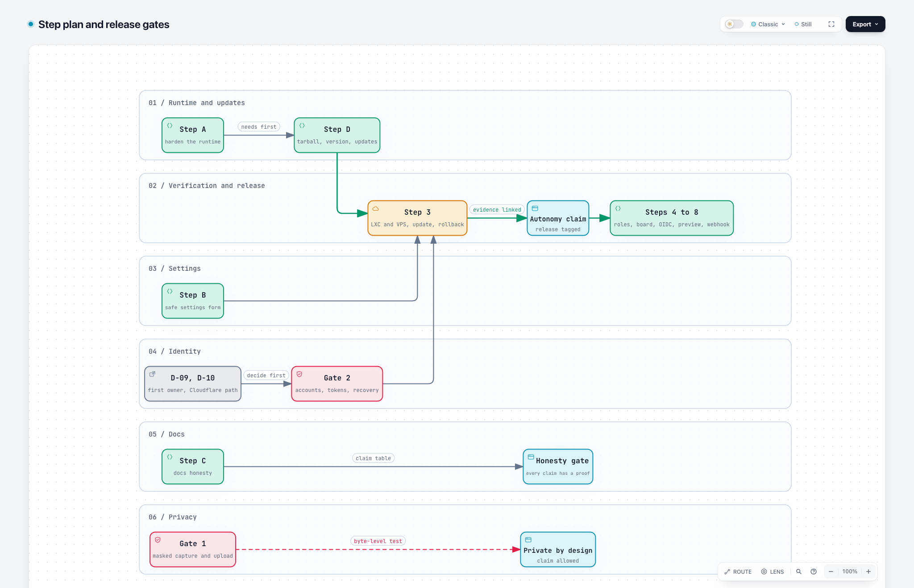
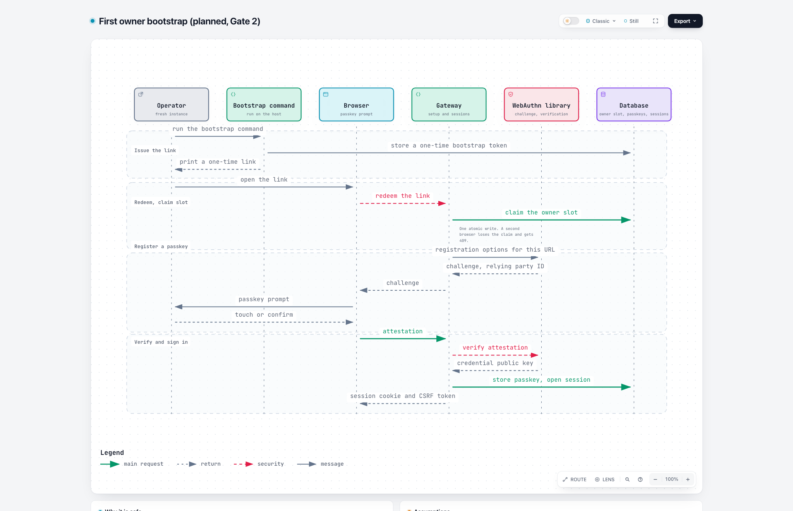
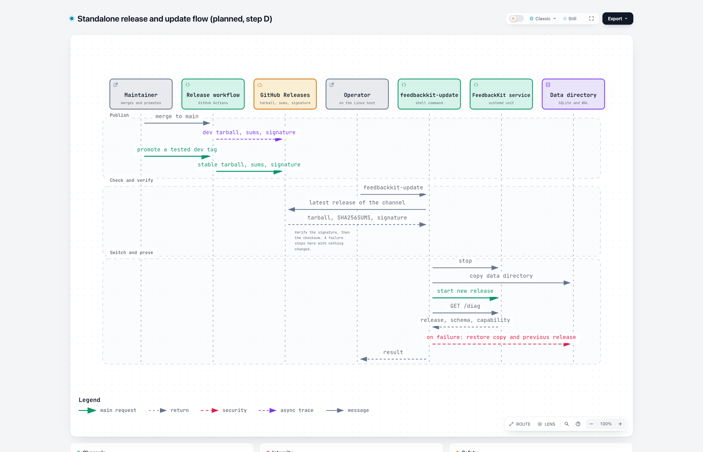

# Autonomous FeedbackKit: plan and delivery steps

Status: proposed, challenged on 2026-11-10. Product boundary and open decisions: [scope.md](scope.md). Who does what and what proves it: [journeys.md](journeys.md). This page says in which reviewable steps the gaps close and how each step is accepted.

## Outcome

An operator runs the complete feedback process on any Linux host (a home Proxmox LXC, a Hetzner server, any VPS): local storage, local accounts with passkeys, optional OIDC and a local AI endpoint. Cloudflare stays as the managed option for operators who do not want to host anything. GitHub, remote AI and mail are optional. Humans and setup agents get install and configuration guides that state what was verified.

## Product structure

| Area | Target |
|---|---|
| Instance | First-run owner setup, public URL, storage and retention, shared AI and GitHub connections, health and update information |
| People | Invitation-only accounts with passkeys on both runtimes, optional OIDC, two roles (owner, member), project access, session revocation, recovery with a one-time link, scoped API tokens that replace `ADMIN_TOKEN`. No public sign-up, no mandatory mail |
| Projects and types | Any number of types, each with labels, guidance, fields and a destination. IDs stay fixed. Instance defaults can be overridden |
| Inbox and log | Local reports have a board view over open, done and dismissed. GitHub deliveries are logged, linked and retried. Their ticket state is never mirrored |
| Privacy | Images stay in the browser until the visitor confirms. Masks are burned into the pixels before upload, thumbnail and AI call. Private elements and password fields are not captured. No automatic detection is promised |

## Where the branch stands

Measured at `3f3caba` on 2026-11-10 (static review, seven specialist passes, an adversarial pass, isolated probes on Node 26).

| Area | State | Evidence |
|---|---|---|
| Standalone runtime | Works on a developer machine. Not release-ready | Two server tests pass. systemd, an LXC and a real GitHub delivery were not run. No release artifact exists |
| Settings form | Works for edits. Unsafe to ship | `pnpm check:bundle` fails (admin 28.4 kB gz, budget 15 kB). Two e2e runs fail |
| Create-only project API | Works. Incomplete | No Worker test, no error codes, no snippet in the response |
| Accounts, OIDC, roles | Not built | The only credential is `ADMIN_TOKEN` |
| Board, masks, previews | Not built | Not started |

## Findings that change the plan

Each finding is assigned to a step. IDs are stable so later reviews can refer to them.

| ID | Finding | Step |
|---|---|---|
| R1 | A request path starting with `//` replaces the canonical origin and skips the origin allowlist (reproduced) | A |
| R2 | Failed-login lockout runs before the token check and is shared behind a proxy. 21 wrong tokens lock out the right one (reproduced) | A |
| R3 | `X-Forwarded-For` is read from the left, so a client can pick its own address (reproduced) | A |
| R4 | Admin screenshots cannot load with token auth, and each refused request counts toward the lockout | A, then Gate 2 |
| R5 | A failing sweep on start ends the process. At least one of two concurrent first starts fails (10 of 10 trials). `busy_timeout` is set after WAL | A |
| R6 | `delivery_capability` is overwritten on every start. No guard against newer schema or settings | A |
| R7 | The whole process environment is visible to settings that name secrets. `llm.baseUrl` receives the AI key | A, then Step 4 |
| R8 | Deleted attachments stay in the database file. Blobs never shrink the file | A |
| R9 | Dockerfile, Compose file and the CI image job were never run and carry development dependencies. Docker is now backlog | A (removal) |
| R10 | Admin bundle over budget. Numbers seed as `1` (retention would delete after one day). Optional strings save as empty | B |
| R11 | IDs are immutable only in the browser. Review can be published after the text changed. JSON and form drafts diverge | B |
| R12 | Create route: no tests, no codes, no snippet. Fresh Cloudflare deploy cannot create local projects | B |
| R13 | Retention lacks the notice guard from the 2026-10-24 plan | B |
| R14 | Docs: Node version, rollback claim, broken anchor, `Discarded` against `Dismissed`, missing standalone threat model | C |
| R15 | Picked images upload at once and the remove button keeps the object. Private elements are not excluded. Rectangle is a frame | Gate 1 |
| R16 | Uploads without a report never expire when no retention is set. No quota | Gate 1, A |
| R17 | The standalone server has no release artifact: installs build on the target, `/diag` reports `0.0.0` and `local`, releases carry only `widget.js`, there is no update command and no notice of a newer release | D |

## Steps

[Open the explorable diagram](diagrams/step-plan.html).

Each step is one reviewable PR (or a small series) with its own tests and docs. The spec fields are Why, Capabilities, Constraints, Non-goals and Success signals. UI changes follow mock before build and go to the maintainer for merge.

### Step A: harden the standalone runtime

- **Why:** the first runtime layer can lock out the operator, trust the wrong origin and lose or keep data wrongly.
- **Capabilities:**
  - Build request URLs by appending to the canonical origin. Reject paths that start with `//`.
  - Check the token first. Count only wrong credentials. Take the client address at a configured trusted-hop position from the right and validate it.
  - Guard the start sweep, set `busy_timeout` first, check migrations inside the transaction, use `synchronous=NORMAL`, `secure_delete=ON`, `auto_vacuum=INCREMENTAL`.
  - Pass an allowlist of environment variables to the application. Keep `delivery_capability` at the maximum. Refuse to serve settings that need a newer release.
  - Load admin images with the Authorization header and show them from object URLs.
  - Remove `Dockerfile`, `compose.yaml`, `.dockerignore`, the CI image job and the Docker section of the README. One Node floor (24 LTS).
- **Constraints:** same Hono app, no new runtime dependency, Worker behavior unchanged and proven by the existing suite. A stricter `patSecret` rule warns on load and rejects on write, so stored settings keep working.
- **Non-goals:** accounts, masks, new screens.
- **Success signals:** every reproduced probe of the review is a test (R1 to R3, R5, R6). One conformance suite passes on both runtimes. No Docker file remains on the branch.

### Step B: settings that are safe by construction

- **Why:** the form changes production settings, so it must not be able to destroy an operator's data.
- **Capabilities:**
  - Drive the form from a generated schema descriptor, not from zod in the browser. `pnpm check:bundle` passes without raising the budget.
  - Never seed numbers or enums with a destructive value. Empty required fields stay empty until filled. An emptied optional field is removed.
  - The review step lists the effect of a retention change in reports and attachments, and the server refuses a retention that would delete before its notice period.
  - The server enforces unique type and field IDs and keeps published IDs. Removing a type archives it.
  - A review covers exactly the text that is published. One draft feeds form and JSON. Locked IDs refresh after publish.
  - The create API returns the snippet, uses error codes, is documented in `docs/ERRORS.md` and tested on the Worker runtime. A fresh Cloudflare deploy records delivery capability.
  - Correct the e2e expectation that requires `undefined` keys.
- **Constraints:** form and JSON stay equal in power. Keep the escape hatch.
- **Non-goals:** new navigation, board, accounts.
- **Success signals:** `pnpm typecheck`, `pnpm test`, `pnpm check:bundle`, `pnpm e2e` and `pnpm test:server` are green. e2e covers add-setting, reorder, remove, JSON round trip, stale save and the New project dialog.

### Step C: scope and documentation honesty

- **Why:** the repo must say what it does, and every claim must have a proof.
- **Capabilities:** the three documents of this change, ADR-016 as proposed, the roadmap backlog line, a standalone section in `docs/SECURITY.md` (proxy, attachment route, deletion guarantee), corrected anchors, one term for each state, one Node version, and a claim table that links each statement about runtime, rollback and deletion to a test or a step.
- **Constraints:** documentation only. A claim without a proof is removed or marked planned.
- **Non-goals:** behavior changes.
- **Success signals:** link check passes. Every row of the claim table names its proof.

### Gate 1: masked capture and upload contract (blocks the "private by design" claim)

- **Why:** an original image that reaches the server cannot be called masked, whatever the screen shows afterwards.
- **Capabilities:**
  - A solid mask tool, rasterized into the pixels. Mask, thumbnail, upload and AI input come from the same bytes.
  - Images stay in memory until the visitor confirms. Removing one leaves no server copy. EXIF is stripped.
  - Capture skips elements marked private and password fields.
  - A project can require a widget marker on uploads. Uploads that no report claims expire.
- **Constraints:** mock before build. The widget budget is 23 kB gz and has 0.2 kB left, so the mask tool loads on demand or the budget is changed by decision. No promise of automatic detection.
- **Non-goals:** replay, OCR, automatic redaction.
- **Success signals:** a Chromium test decodes every request body for each input path (capture, pick, paste, drop, retry) and shows that masked regions differ from the original, with a negative control that fails without the mask. A server test rejects unmarked uploads for projects that require the marker.

### Gate 2: local accounts and recovery (blocks the "autonomous" claim)

- **Why:** without it the only credential is a shared static token that can be locked out by anyone.
- **Capabilities:** sessions with CSRF protection, bootstrap and recovery by a one-time link from a host command (D-09), scoped API tokens for scripts and agents (created by an owner, hashed at rest, shown once, revocable), `ADMIN_TOKEN` ends once the first owner exists, a D1 design for the atomic owner claim and one-time tokens, a recovery path for Cloudflare (a script run with the operator's Cloudflare credentials), passkeys through a maintained WebAuthn library, last-owner protection, revocation, admin images through the session, a threat model in `docs/SECURITY.md`.
- **Constraints:** no hand-written protocol. Passkeys need HTTPS or localhost, and the relying party ID follows `FK_PUBLIC_URL`, which then cannot be changed in the UI. D-02 and D-03 are decided (S11, S12). Decide D-09 and D-10 first.
- **Non-goals:** roles beyond owner and member, OIDC, public sign-up.
- **Success signals:** concurrent bootstrap yields one owner. A virtual authenticator completes enrollment and sign-in. A recovery drill works on a clean instance. A valid login is never blocked by other people's failed attempts, with and without a proxy. The old `ADMIN_TOKEN` is refused after bootstrap and a scoped token works for automation. One conformance suite runs bootstrap, sign-in and recovery on SQLite and on D1.

[Open the bootstrap sequence](diagrams/gate2-bootstrap-sequence.html). The other Gate 2 flows are [sign-in](diagrams/gate2-signin-sequence.html), [recovery](diagrams/gate2-recovery-sequence.html), [scoped tokens](diagrams/gate2-token-sequence.html) and [account states](diagrams/gate2-account-lifecycle.html). They are planned designs. They follow the decisions S11 and S12 and assume D-09 as recommended. Token lifetime, command name and cookie attributes are decided in the PR.

### Step D: release tarball, version and updates

- **Why:** operators should install and update a finished release, without Git, pnpm or a compiler on the server (R17).
- **Needs first:** Step A (capability guard, start sweep, conformance suite).
- **Capabilities:**
  - A CI workflow builds the bundle for every dev tag and every stable tag and attaches `feedbackkit-vX.Y.Z.tar.gz`, `SHA256SUMS` and `SHA256SUMS.sig` to the GitHub release (release strategy below).
  - The tarball holds a single-file server without `node_modules`, widget and admin assets, migrations, the systemd unit, `feedbackkit-update` and `bundle.json` with release, channel, schema version and delivery capability. The server reads these from the bundle and no longer reads `src/shared/contract.ts` at runtime.
  - `/diag` and the System page show the release from `bundle.json`.
  - `feedbackkit-update` with `--check` and `--rollback`, as described in J12. The admin shows a notice for a newer stable release (J2) with an off switch.
  - `docs/SELF_HOSTING.md` describes install and update from the tarball. The clone-and-build path moves to `CONTRIBUTING.md` as the developer path.
- **Constraints:** the target needs Node.js 24 and the standard tools curl, tar, sha256sum and ssh-keygen, nothing else. Everything the repo ships is English: release notes, command output, docs and `bundle.json`. The admin notice has `en` and `de` keys, as `CONTRIBUTING.md` requires for user-facing strings. Nothing updates without an operator command. The update check is one plain request to the GitHub Releases API and sends nothing about the installation. One bundle serves every Linux target. The update script is POSIX shell and CI tests it on fixtures.
- **Non-goals:** a Docker image, an npm registry package, an auto-update daemon, delta updates, init systems other than systemd.
- **Success signals:** the workflow produces tarball, checksums and signature from a dev tag (a dry run before the first stable tag). A fresh LXC installs it with only Node and the standard tools. An update from one release to the next keeps the data. A corrupted tarball, a tampered checksum file, a dev-signed stable release and a bad bundle each stop the update and restore the previous state. A key rotation has been rehearsed before the first signed release. `/diag` shows release and channel.

[Open the explorable diagram](diagrams/release-update-sequence.html). It describes the planned flow of this step, not shipped behavior.

Release strategy for the tarball:

| Topic | Rule |
|---|---|
| Versioning | SemVer from git tags (ADR-013). While the version is `0.x`, a minor release may break, and the release notes say so |
| Channels | `stable` (`vX.Y.Z`, the GitHub release marked latest) and `dev` (`vX.Y.Z-dev.N`, marked pre-release). The default is stable. `feedbackkit-update --channel dev` opts in. No `rc` tag: a tested dev build is promoted by hand |
| Build | Every merge builds a dev tarball. Promotion rebuilds the same commit under the stable version (ADR-013). CI checks that the dev and stable bundles of one commit are byte-identical except `bundle.json`, so what was tested is what ships |
| Retention | GitHub keeps the newest three dev pre-releases (ADR-013). Stable releases stay |
| Integrity | `SHA256SUMS` is signed with the release key of its channel (S10) and checked with `ssh-keygen -Y verify`. The public key ships in every bundle and in the docs. A checksum next to the tarball detects corruption only. The signature detects tampering |
| Update notice | Uses GitHub's latest-release endpoint, which skips pre-releases (on this repo it returns `v0.1.18` while `v0.1.19-dev.1` exists). On the dev channel it also offers newer dev builds |
| Skipping releases | `bundle.json` names the oldest release a data directory can update from. The update command walks through intermediate releases when needed |
| Rollback | The two newest releases stay on disk. Migrations only add, so one release back works on the newer schema. Beyond that the update command restores the data copy |
| Support | Only the latest stable release gets fixes. A bad stable release is pulled by marking it pre-release and publishing a fixed patch |

### Step 3: verification on a fresh host

- **Why:** a build that passes on a laptop says little about an LXC.
- **Capabilities:** run J1, J2, J12 and J14 from the release tarball on a clean Debian LXC and on a clean cloud VPS (for example at Hetzner). Outbound traffic is allowed for the download and blocked until the first report. Include an update with data and a rollback. Update the status of each journey with the evidence.
- **Success signals:** transcripts and results are linked from the journeys. Only now may README and docs say the gateway runs without Cloudflare. Tag the release after this step.

### Steps 4 to 8, after the gates

| Step | Content | Needs first |
|---|---|---|
| 4 | Member role, project access, authorization on assets and feedback by project, instance-level AI and GitHub connections referenced by ID | Gate 2 |
| 5 | Types navigation and board view over the three states | Approved mock, D-05 |
| 6 | OIDC through a maintained library, binding by `iss` and `sub` | Gate 2, D-04, upstream docs read |
| 7 | Widget preview and theme tokens (#57) | Approved mock, contrast rules |
| 8 | Signed webhook (#58) | None, optional |

## Release gates

| Gate | Condition |
|---|---|
| Autonomy | Steps A, B, D, Gate 2 and Step 3 are done. Until then no document claims independence from Cloudflare |
| Privacy | Gate 1 is done. Until then no document claims masked or private screenshots |
| Honesty | Step C is done and every claim in the claim table has a proof |

## Definition of done for every step

- The tests named in the step pass in CI. A green build is not evidence of behavior.
- Docs change in the same PR: README, `ADMIN.md`, `SELF_HOSTING.md`, `ERRORS.md`, `SECURITY.md` as affected.
- The affected journeys in [journeys.md](journeys.md) get their new status, and their `Verified` lines are repeated against the code or a live run.
- A decision that changes scope gets an ADR. A new error gets a code.
- The PR body starts with its issues (`Fixes`, `Refs` or `No issue`). Parent epics #1, #2 and #6 stay open until their acceptance criteria are met.

## Related public issues

| Work package | Existing issues | Step |
|---|---|---|
| Admin, types and first run | #55, #59, #6 | B, 5 |
| Theme and preview | #57 | 7 |
| Independent operation and docs | #60, local part of #3, #69, #72 | A, C, D, 3 |
| Privacy and screenshot reliability | PII part of #127, #128, #129 | Gate 1 |
| Optional delivery integrations | #58, webhook part of #127 | 8 |

#112 is a consumer rollout after a stable gateway. #56 and #61 improve optional setup paths and do not block local use. #1 and #2 are not sprint commitments. #94 is praise and #107 a triage log. #66 needs a check against the current version, #67 and #95 are separate marketing slices. #128 and #129 look like duplicates and need one shared reproduction first.

Reports filed in embedding-app repositories need triage per component. Carry over a neutral summary only. Do not copy account context, private attachments or unrelated requests from other apps into this public repository.

Co-created by Michel with NORA (AI Agent)
