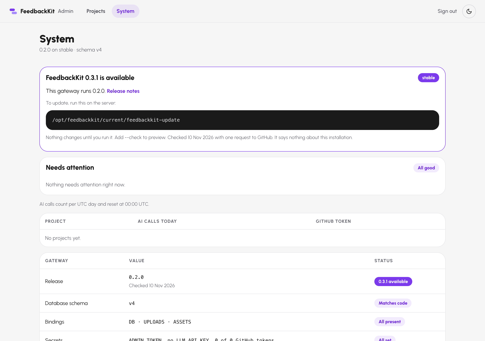
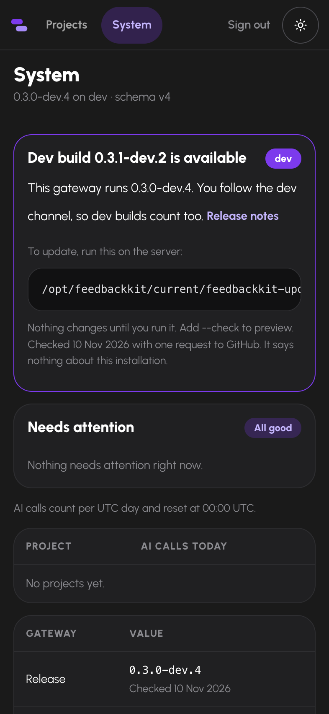
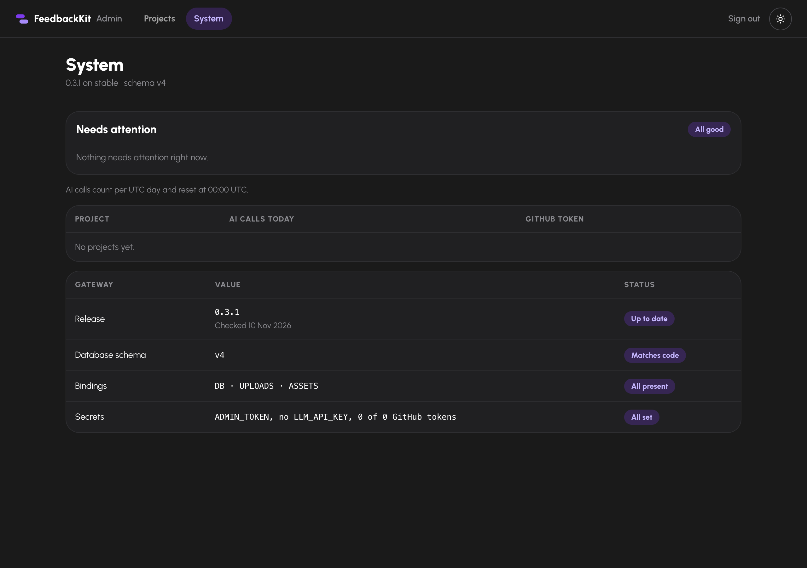
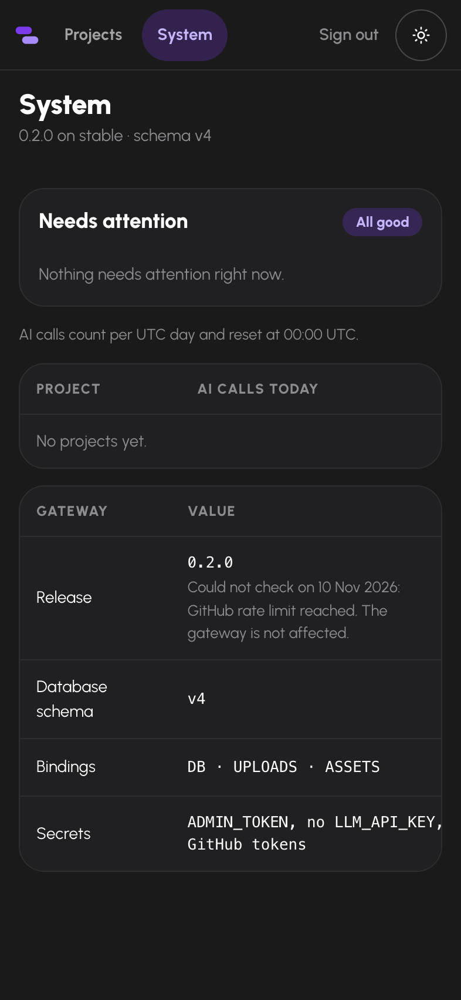

# Evidence: the notice for a newer release (journey J2)

Run on 2026-11-10 against the branch that builds the notice. A tarball server built with `scripts/build-bundle.mjs` (and a checkout server for the last row) ran next to a fake release API on localhost, which the server reached through `FK_UPDATE_API`. The pages were loaded in the installed Google Chrome on a desktop viewport (1280 by 900) and on a phone (393 by 851, touch), each in light and dark: 24 page loads in eight situations. The driver script is not committed.

| Situation | What the API saw | What the gateway sent | What the page showed (desktop, light) |
|---|---|---|---|
| stable install 0.2.0, GitHub has 0.3.1 | `GET /repos/TruffleCraft/feedbackkit/releases/latest` | `state: available`, `latest: 0.3.1` | card "FeedbackKit 0.3.1 is available"; Release row: 0.2.0 Checked 10 Nov 2026 0.3.1 available |
| dev install 0.3.0-dev.4, GitHub has 0.3.1-dev.2 | `GET /repos/TruffleCraft/feedbackkit/releases?per_page=30` | `state: available`, `latest: 0.3.1-dev.2` | card "Dev build 0.3.1-dev.2 is available"; Release row: 0.3.0-dev.4 Checked 10 Nov 2026 0.3.1-dev.2 available |
| stable install 0.3.1, GitHub has 0.3.1 | `GET /repos/TruffleCraft/feedbackkit/releases/latest` | `state: current`, `latest: 0.3.1` | no card; Release row: 0.3.1 Checked 10 Nov 2026 Up to date |
| GitHub answers 500 | `GET /repos/TruffleCraft/feedbackkit/releases/latest` | `state: failed`, `reason: GitHub answered 500` | no card; Release row: 0.2.0 Could not check on 10 Nov 2026: GitHub answered 500. The gateway is not affected. Check failed |
| GitHub rate limit (403, remaining 0) | `GET /repos/TruffleCraft/feedbackkit/releases/latest` | `state: failed`, `reason: GitHub rate limit reached` | no card; Release row: 0.2.0 Could not check on 10 Nov 2026: GitHub rate limit reached. The gateway is not affected. Check failed |
| GitHub unreachable (nothing listens) | nothing | `state: failed`, `reason: GitHub could not be reached` | no card; Release row: 0.2.0 Could not check on 10 Nov 2026: GitHub could not be reached. The gateway is not affected. Check failed |
| tarball install with FK_UPDATE_CHECK=off | nothing | no `update` field | no card; Release row: 0.2.0 stable |
| checkout install (no bundle.json) | nothing | no `update` field | no card; Release row: 0.0.0 local |

The phone and dark loads showed the same texts, badge classes and states. Only the colors differ.

What the browser requested, in every load: `/admin/system`, `/admin.js`, `/urbanist.woff2`, `/api/admin/me` and `/api/admin/system`, all on the gateway's own origin. Nothing went to GitHub or anywhere else. No load logged a console error or a Content-Security-Policy violation, and none scrolled the page sideways.

What the API saw: one request per situation, never two, with `accept: application/vnd.github+json`, `user-agent: feedbackkit-update-check` and the defaults Node adds (`accept-encoding`, `accept-language`, `connection`, `host`, `sec-fetch-mode`). No authorization, cookie or referer, and no version.

A separate check against the real GitHub API, with the function the server uses: a stable 0.1.0 install is offered 0.1.18 (`state: available`), a dev 0.1.19-dev.1 install is offered 0.1.19-dev.4, and a 99.0.0 install gets `state: current`. The link to the release notes built from it is `https://github.com/TruffleCraft/feedbackkit/releases/tag/v0.1.18`.

## Screenshots

Co-created by Michel with NORA (AI Agent)
