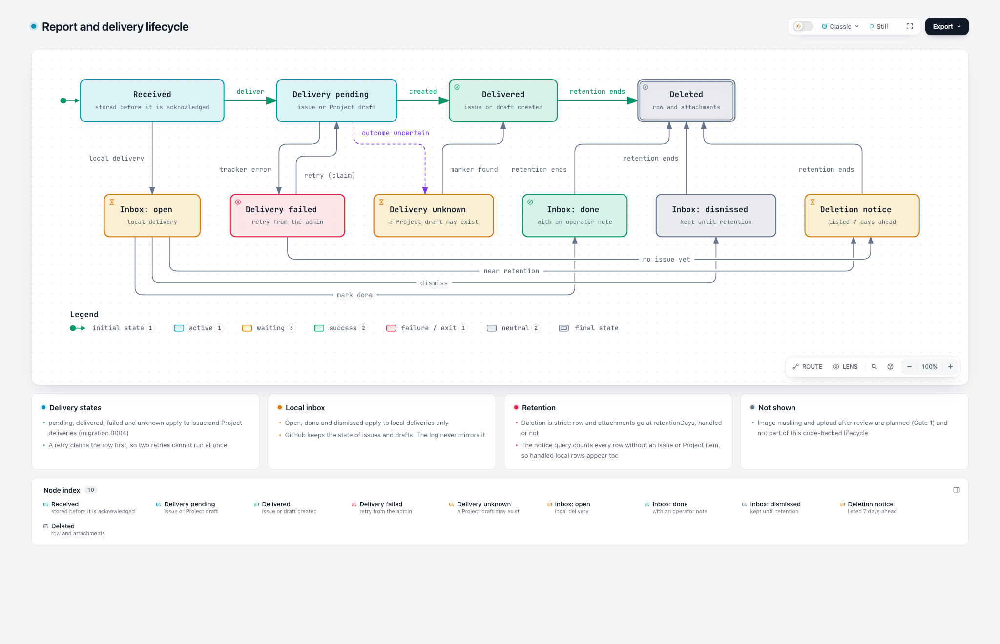

# Journeys

One page per question: who does what, what the system guarantees, what proves it. Status is measured against the WIP branch `codex/admin-self-hosting` at `3f3caba` and the review of 2026-11-10. A journey is `works` only when the evidence named here exists and passes. A mock, a build or a passing unit test does not move it.

Every `Today` statement ends in a `Verified` line: the kind of evidence, the date and what to run to repeat it. Kinds are `live` (run against a real process or browser), `test` (an existing test that passes), `code` (read at a file and line) and `doc` (read in the documentation). A statement without a `Verified` line is a claim, not a fact. Probes ran on Node 26.12 against the WIP checkout `3f3caba`.

Roles and examples are fictional. Robin runs `example.org` and operates the gateway. Sam visits the site and sends a report. Taylor is a teammate Robin invites. The setup agent is an LLM with terminal access.

Scope and non-goals are in [scope.md](scope.md). The steps that close the gaps are in [the plan](autonomous-admin-plan.md).

| ID | Journey | Status today | Gate |
|---|---|---|---|
| J1 | Install on a Linux host (LXC, Hetzner, any VPS) | partly | autonomy |
| J2 | Robin sees which release runs and that a newer one exists | works | autonomy |
| J3 | Bootstrap the first owner | works on both runtimes, screens clicked in Chrome | autonomy |
| J4 | Create a project and receive a first report | partly | autonomy |
| J5 | Define feedback types, fields and destinations | partly | none |
| J6 | Sam sends a report with a screenshot | works, unmasked | privacy |
| J7 | Sam attaches an own image | gap | privacy |
| J8 | Robin triages the local inbox | partly | none |
| J9 | Robin follows a GitHub delivery | works on Cloudflare, unverified standalone | none |
| J10 | Taylor signs in | works with a passkey, no OIDC | autonomy |
| J11 | Robin is locked out and recovers | works, screens clicked in Chrome | autonomy |
| J12 | Upgrade and roll back | partly | autonomy |
| J13 | Reports expire | partly | privacy |
| J14 | A setup agent installs and verifies | draft | autonomy |
| J15 | Robin changes the widget look and previews it | partly | none |
| J16 | Robin creates a scoped token for an agent or script | works, screens clicked in Chrome | autonomy |
| J17 | Robin embeds the team board in the product's own admin UI | planned | autonomy |
| J18 | Sam follows their own reports | planned | autonomy |
| J19 | Robin moves a gateway from Cloudflare to the standalone server | works | autonomy |
| J20 | Robin connects an agent to the gateway through MCP | works on Cloudflare. Standalone: plumbing built, off, blocked on accounts | autonomy (consent through accounts) |

## Diagrams

[Open the report lifecycle](diagrams/report-lifecycle.html) (J8, J9, J13, backed by code at commit `e712a01`). The planned install and update flow (J1, J2, J12) is in [release-update-sequence.html](diagrams/release-update-sequence.html). The planned Gate 2 flows (J3, J10, J11, J16) are [bootstrap](diagrams/gate2-bootstrap-sequence.html), [sign-in](diagrams/gate2-signin-sequence.html), [recovery](diagrams/gate2-recovery-sequence.html), [scoped tokens](diagrams/gate2-token-sequence.html) and [account states](diagrams/gate2-account-lifecycle.html). The planned image path for J6 and J7 is [privacy-image-path.html](diagrams/privacy-image-path.html).

## J1 Install on a Linux host

- **Goal:** Robin has a running gateway on a Linux host (a home LXC, a Hetzner server or any VPS) from a finished release, without Git, pnpm, Docker or a Cloudflare account.
- **Steps:** install Node.js 24 LTS, download the release tarball, `SHA256SUMS` and `SHA256SUMS.sig`, verify signature and checksum, extract to `/opt/feedbackkit`, install the systemd unit from the tarball, fill the environment file, start.
- **Guarantees:** a failed signature or checksum stops the install. The service refuses to start with a weak admin token or a bad public URL. Migrations run once. The first sweep cannot keep the service from starting. `/diag` is green only when schema and capability match, and it shows the release.
- **Failure paths:** two starts at once on one data directory (both come up since Step A, `test/server-storage-hardening.test.mjs`), a failing start sweep (the process exits with code 1; systemd would retry under `Restart=on-failure` and give up after its start limit, which was not run), a Node release without `node:sqlite`.
- **Evidence:** a fresh Debian LXC and a fresh cloud VPS, each with only Node, curl and tar installed. Installation from the docs to a green `/diag` that shows the release number, then reboot and restart tests. Outbound traffic is needed once for the download and blocked afterwards until the first report. A conformance suite runs on both runtimes.
- **Today:** no tarball is built. The docs describe a clone, `pnpm install` and a build on the server. That path was run on a clean Debian 13 LXC (unprivileged, no nesting) on 2026-11-10: install, build, systemd, restart, a crash, a reboot and a copy of the data directory all worked ([evidence](evidence/2026-11-10-debian-lxc.md)). Two starts at once no longer fail (Step A). A cloud VPS was not tested, by decision of the owner. A real GitHub delivery from the standalone server was not run.
- **Verified:** `live` the Debian LXC run above and the start refusals (weak token, a path in the public URL, the old `FK_TRUST_PROXY`). `test` `test/server-storage-hardening.test.mjs` (concurrent first start, failing start sweep). Repeat: follow `docs/SELF_HOSTING.md` on a clean container.

## J2 Robin sees which release runs and that a newer one exists

- **Goal:** Robin can tell which release is installed and whether a newer stable one is out.
- **Steps:** open the System page or `/diag`, read release and channel, see a notice when a newer stable release exists, open its release notes.
- **Guarantees:** the release comes from the record inside the bundle. The notice comes from one plain request to the GitHub Releases API, made by the gateway at most once a day (once an hour after a failure) and never by the browser. `FK_UPDATE_CHECK=off` switches it off, and its failure never affects the gateway. No data about the installation is sent. A stable install is never offered a pre-release, a dev install sees dev builds too. Cloudflare and checkouts show no notice.
- **Failure paths:** no outbound access (no notice and no error), a newer release that needs a newer Node, a rate-limited API.
- **Evidence:** unit tests for version comparison and for the switch, and an e2e that shows the notice from a mocked releases response.
- **Today:** a release tarball reports its release and channel from `bundle.json`. A checkout reports `0.0.0` and `local`. `feedbackkit-update --check` says whether a newer release exists. The System page of a tarball install shows the notice: a card above Needs attention when a newer release waits, with the update command and a link to the release notes, and a Release row that says up to date, update waiting or check failed with the reason. The admin is English only.
- **Mock:** the approved mock is [update-notice.html](mockups/update-notice.html), variant A, with the references and the reasoning in [update-notice.md](mockups/update-notice.md). Not built, by decision: a dismiss button and a dot on the System tab (variants B and C).
- **Verified:** `test` `test/server-update-notice.test.mjs` (version comparison, the release pick per channel, the switch, every failure state, the request, the daily cache, and the real server against a fake GitHub for a stable install, a dev install, current, failed, switched off and a checkout), `test/admin-api.test.ts` (the `update` field) and `e2e/admin.spec.ts` (every state on desktop and phone, dark mode). `live` 2026-11-10: the built tarball server and a checkout server loaded in Chrome on desktop and phone, light and dark, against a fake GitHub, and one check against the real GitHub API (a stable 0.1.0 install is offered 0.1.18, a dev 0.1.19-dev.1 install 0.1.19-dev.4), see the [evidence](evidence/2026-11-10-update-notice.md). `live` `pnpm check:bundle`: the admin module is 15,520 bytes gzipped against a budget of 15,616. Repeat: `node --test test/server-update-notice.test.mjs` and `pnpm e2e`.

## J3 Bootstrap the first owner

- **Goal:** the first person to reach a fresh instance can become owner only if they control the installation.
- **Steps:** the operator proves control with a one-time link from a host command (S14), registers a passkey, the instance records exactly one owner. `ADMIN_TOKEN` grants nothing afterwards (S11).
- **Guarantees:** two simultaneous attempts produce one owner. No public first-user route exists. The last owner cannot be removed or demoted.
- **Failure paths:** a second browser races the first, the passkey ceremony fails halfway, the public URL changes after enrollment (passkeys bind to it).
- **Evidence:** integration tests with concurrent requests, a Playwright virtual authenticator, a threat model section in `docs/SECURITY.md`.
- **Today:** the backend is built on both runtimes: `feedbackkit-admin setup-link` (or `pnpm admin:link` on Cloudflare) issues a 30-minute link, `/api/auth/setup/*` creates the owner with a passkey, and two simultaneous claims yield one owner. `ADMIN_TOKEN` stops working and the server starts without it. The page the link opens (`/admin/setup`) takes a name and creates the passkey, then signs in and offers the admin; the approved mock is [mockups/accounts.md](mockups/accounts.md) (variants C, A, A).
- **Verified:** `test` `test/durable/accounts.test.ts` on workerd with D1 and on SQLite (the claim, the link, the refused `ADMIN_TOKEN`), `test/server-accounts.test.mjs` (the host command and a start without `ADMIN_TOKEN`). `live` 2026-11-11: `e2e/accounts-real-server.spec.ts` in Chrome with a virtual authenticator, including two browsers racing for the link; the clean-LXC drill in the [evidence](evidence/2026-11-11-gate2-accounts.md). `e2e/accounts-ui.spec.ts` clicks the setup page in the same Chrome run (a name is required, the link leaves the address bar, a spent or invalid link says so, an insecure address and a browser without passkeys keep the button off). Repeat: `pnpm test` and `pnpm exec playwright test e2e/accounts-real-server.spec.ts e2e/accounts-ui.spec.ts`.

## J4 Create a project and receive a first report

- **Goal:** from a signed-in admin to a first report in the inbox.
- **Steps:** New project (ID, origin, language), copy the snippet, paste it into the site, send a test report, open the inbox.
- **Guarantees:** creating never overwrites. The response contains the snippet. Errors carry codes from `docs/ERRORS.md`.
- **Failure paths:** duplicate ID (409, exists), origin typo, Cloudflare gateway without delivery capability (the create call is refused with 422 on a fresh deploy, found by reading the code, not yet reproduced).
- **Evidence:** unit tests for the create route on the Worker runtime, an e2e for the dialog (success, 409, invalid origin, network failure).
- **Today:** the dialog and route work on the standalone server. The dialog posts a local-delivery config, redirects to the project page and rejects an origin with a path. The route has no Worker-side test and no error codes. The response omits the snippet that `AGENT_SETUP.md` tells agents to install.
- **Verified:** `live` browser run of the New project dialog against a mocked API (posted body, redirect to `#setup`, origin message) and the `test:server` run (201 and 409 on a real server). `code` `src/worker/admin/routes.ts` response fields, `docs/AGENT_SETUP.md:45`, `src/worker/admin/config-write.ts` (422 when the stored capability is lower than the one a config needs, and a missing `delivery_capability` row counts as 0). The Cloudflare 422 itself was not run. No vitest test posts to the route.

## J5 Define feedback types, fields and destinations

- **Goal:** Robin adds Bug and Feature request, each with its own questions, required fields and destination.
- **Steps:** open Settings, add a type, add fields, pick a destination (inbox, issue, project), review the diff, publish.
- **Guarantees:** type and field IDs are unique and never change once published, enforced by the server. Removing a type archives it. Numbers and enums never start with a destructive value. A publish needs a review of exactly the text that is published.
- **Failure paths:** two admins publish at once (409 exists), a reload mid-edit, JSON edits while the form is open.
- **Evidence:** server tests for duplicate and renamed IDs, e2e for reorder, remove, JSON round trip and stale save.
- **Today:** the form exists. IDs are locked only in the browser: the contract accepts duplicate type IDs and duplicate field keys. A review can be published after the text changed during the request. A JSON edit made while Advanced JSON is open is lost when a form field changes.
- **Verified:** `live` contract probe (duplicate type IDs and field keys accepted) and a browser run (a `privacyUrl` typed into the JSON is gone after a form edit). `code` `src/admin/main.ts` sets `checked = ta.value` after the validate request returns, not the text that was validated.

## J6 Sam sends a report with a screenshot

- **Goal:** Sam describes a problem, answers one follow-up, sends. The report reaches its destination and nothing sensitive leaves the page unmasked.
- **Steps:** open the widget, type, review the captured screenshot and mask areas, answer the follow-up, confirm.
- **Guarantees:** the report is confirmed only after it is stored. The screenshot Sam reviewed is the screenshot uploaded and the one the AI sees. Form values and password fields are masked and elements marked `data-fk-private` are blocked out before the capture is rasterized. A project whose destination is public or unreadable always uses the strict profile, where text and images in the capture are covered unless an element is marked `data-fk-show` ([concept](privacy-masking.md)).
- **Failure paths:** AI error (the report goes out unenriched), storage error (retryable 503), tracker error (kept, retry in admin), network loss (the text survives a retry).
- **Evidence:** exists for loss paths. New: a Chromium test that decodes the request bodies and shows masked pixels differ from the original, plus a negative control. The full list is in the [acceptance table](privacy-masking.md#acceptance).
- **Today:** loss handling works. There is no mask tool (the rectangle is a frame), no exclusion of private elements, and the AI receives whatever the capture produced.
- **Verified:** `test` `test/widget.test.ts:116-135` and `e2e/feedback.spec.ts:129` (a 503 keeps the report and the retry resends it without uploading again, passed in my run). `code` `src/widget/ui/annotate-model.ts` draws the rectangle with `strokeRect` only, the capture filter in `src/widget/lib/screenshot.ts:58` excludes only the widget's own host element, `src/worker/llm/client.ts` sends `screenshotDataUrl` as received.

## J7 Sam attaches an own image

- **Goal:** Sam adds a photo or screenshot of their own and masks parts of it before anything is sent.
- **Steps:** pick an image, see it locally, mask areas, remove it if wanted, send with the report.
- **Guarantees:** the image stays in the browser until the final confirmation. Removing it leaves no server copy. EXIF data is stripped.
- **Failure paths:** a huge or malformed file, a tab closed before sending, an old widget that uploads on pick.
- **Evidence:** the same byte-level test for every input path (capture, manual pick, paste, drop, retry), and a server test that rejects unmarked uploads for projects that require masking.
- **Today:** a picked image uploads at once. The remove button drops the key, not the stored object. A project without a retention period never expires uploads that no report claims.
- **Verified:** `code` `src/widget/index.ts:396-404` uploads on pick and `:196-200` removes only the key from the local list. `src/worker/storage/r2.ts:57` sets `expires_at` only when a retention period exists and `:89` sweeps only rows with an `expires_at`.

## J8 Robin triages the local inbox

- **Goal:** Robin works through local reports and keeps GitHub reports in GitHub.
- **Steps:** open the inbox, look at a report and its screenshot, mark it open, done or dismissed, add a note, optionally copy it for an agent.
- **Guarantees:** only local reports have a local state. A board view shows the same three states. Screenshots load for a signed-in admin and for nobody else. Opening a list never counts as a failed login.
- **Failure paths:** screenshots behind token auth, a state value an older reader does not know.
- **Evidence:** e2e in a real browser with token auth and with a session, a test that a new state value is rejected until readers handle it.
- **Today:** list, states, notes and delete work. With a bearer token the screenshot `` cannot authenticate, and each refused request counts toward the login lockout.
- **Verified:** `live` 25 header-less requests to `/admin/assets/...` return 401 and then 429 from the 21st, and the correct token is then refused with 429. `test` `e2e/admin.spec.ts` (39 passed, 1 skipped in my run) covers list, filters, states, notes and delete against a mocked API.

## J9 Robin follows a GitHub delivery

- **Goal:** Robin sees whether a report arrived, where it went and whether delivery worked, and retries when it did not.
- **Steps:** open the delivery log, follow the link to GitHub, retry a failed or uncertain delivery.
- **Guarantees:** the log never claims the current GitHub status. An uncertain result is shown as uncertain. A retry does not create a duplicate.
- **Failure paths:** token without Projects permission, a field that does not exist, a delivery that may have succeeded.
- **Evidence:** exists on the Worker with mocked GitHub. New: one real, authorized test delivery per runtime, with the destination checked by hand.
- **Today:** the delivery model is on `main`. The standalone server has not delivered to a real GitHub destination.
- **Verified:** `doc` commits `ec76887`, `403de94`, `f8f6730` on `main`. `test` `test/delivery.test.ts` (11 tests) and `test/admin-delivery.test.ts` (12 tests) pass with mocked GitHub in my run. No real delivery was run on either runtime in this review.

## J10 Taylor signs in

- **Goal:** Taylor joins by invitation and signs in with a passkey or the operator's identity provider.
- **Steps:** Robin invites Taylor to a project, Taylor opens the link, registers a passkey or signs in through OIDC, lands in the project.
- **Guarantees:** invitations are single use and expire. OIDC identities bind by `iss` and `sub`. Sessions can be revoked. Taylor sees only the invited projects.
- **Failure paths:** reused or expired invitation, an identity provider that returns an unverified email, a deleted passkey.
- **Evidence:** tests for state, nonce and PKCE, for cross-project denial and for revocation. Libraries for WebAuthn and OIDC, no hand-written protocol.
- **Today:** an owner invites a member (or another owner) and gets a 7-day single-use link. The person enrolls a passkey and signs in. A member uses every admin route except accounts and tokens until Step 4 adds authorization by project. OIDC is not built (Step 6). The invitation is a dialog on the Accounts screen: the owner copies the link and can make a new one, and the person opens it, creates a passkey and lands in the admin.
- **Verified:** `test` `test/durable/accounts.test.ts` ("an owner invites a member ...", "an expired invitation can be renewed ...", "removing an account signs it out and revokes its tokens"), both runtimes. `live` `e2e/accounts-ui.spec.ts` in Chrome: invite, copy, new link, the invited person's passkey, what a member sees (no Accounts, no API tokens), make owner, make member, remove, show removed, and the removed person's session ending.

## J11 Robin is locked out and recovers

- **Goal:** Robin regains access without a vendor and without opening the instance to others.
- **Steps:** run a recovery command on the host (on Cloudflare a script with the operator's Cloudflare credentials), receive a one-time link, set up a new passkey, old sessions are revoked, and so are the API tokens that account created (the owner makes new ones).
- **Guarantees:** recovery needs host access, or on Cloudflare the operator's Cloudflare credentials. A valid login is never blocked by the failed-login counter of other people.
- **Failure paths:** all passkeys lost, the identity provider is down, a flood of wrong tokens from other visitors.
- **Evidence:** a test with and without a reverse proxy that 25 wrong tokens do not block the right one. A recovery drill on a clean instance.
- **Today:** the account system never refuses a valid credential because of failed attempts. Failures are counted per hashed address and per account and answered `429` over the limit. `recovery-link` (or `pnpm admin:link --recovery`) issues a link that replaces the passkeys, signs out the sessions and revokes the API tokens the account created (`--keep-tokens` opts out); the setup page reports how many ended. The legacy `ADMIN_TOKEN` keeps its old lockout until the first owner exists. The sign-in page links to the host commands under "Locked out?", and the recovery link opens the same setup page with a warning about what it replaces.
- **Verified:** `test` "failed sign-ins are throttled without refusing a valid one" and the token variant (both runtimes), and `test/server-accounts.test.mjs` on the real server with `FK_TRUSTED_PROXY_HOPS=1` and without it. `live` the recovery drill in Chrome (`e2e/accounts-real-server.spec.ts`, and through the screens in `e2e/accounts-ui.spec.ts`: no passkey found, the host link, the warning, the count of revoked tokens, another browser's session ended) and on a clean LXC ([evidence](evidence/2026-11-11-gate2-accounts.md)).

## J12 Upgrade and roll back

- **Goal:** Robin updates with one command and can go back.
- **Steps:** run `feedbackkit-update`. It reads the installed release, fetches the latest release of the chosen channel (stable by default) with `SHA256SUMS` and its signature, verifies both, stops the service, copies the data directory, switches to the new release directory, starts the service and checks `/diag`. `--check` only reports what it would do. `--rollback` restores the previous release and the copy.
- **Guarantees:** a failed signature or checksum, or a failed health check, restores the previous release and the data copy by itself. Migrations only add. The command refuses a release whose schema or delivery capability is lower than what the data holds. The recorded delivery capability never drops.
- **Failure paths:** an interrupted download, a service that does not come up, a disk that is full, a copy taken while the process writes (the service is stopped first).
- **Evidence:** an upgrade and rollback test on a data directory with real rows, with a bad bundle (health check fails), a corrupted tarball (checksum fails) and a tampered checksum file (signature fails), plus a backup test that includes the write-ahead log.
- **Today:** `feedbackkit-update` exists and passes its tests. It ran under real systemd in a clean Debian 13 LXC with fixture releases: update with data, rollback, update again, a release that does not start, the dev channel. It also ran against the real signed dev builds 0.1.19-dev.5 and 0.1.19-dev.6 on GitHub: install, `--check`, update, rollback, update again ([evidence](evidence/2026-11-10-real-release-lxc.md)). The signed stable release 0.2.0 installed the same way on a clean LXC ([evidence](evidence/2026-11-11-stable-release.md)). An update between two stable releases has not run yet. A checkout install still updates by hand. The capability never drops (Step A).
- **Verified:** `test` `test/server-update.test.mjs` (11 cases) and `test/server-storage-hardening.test.mjs` (the capability). `live` the LXC run ([evidence](evidence/2026-11-10-tarball-lxc.md)). Repeat: `node --test test/server-update.test.mjs`.

## J13 Reports expire

- **Goal:** data disappears when the privacy promise says it does, and nothing disappears by accident.
- **Steps:** Robin sets a retention period, unhandled reports are listed 7 days before deletion, the sweep deletes rows and attachments together.
- **Guarantees:** strict deletion with notice (decided 2026-10-24). Shortening the period never deletes before the notice has run. The review step shows how many reports a change would delete. Deleted attachments do not stay readable in the database file.
- **Failure paths:** a form that seeds one day, a clock that jumps forward, a sweep that fails on start.
- **Evidence:** tests for the notice guard and the count, a test on the file that a deleted blob's bytes are gone, a startup test with a failing sweep.
- **Today:** deletion is strict and retroactive. The form can seed one day. Freed pages keep their content until reused.
- **Verified:** `live` browser run: choosing "Delete after (days)" under "Add Attachments & retention setting" puts `retentionDays: 1` into the draft. `live` SQLite probe: `secure_delete` is 0 and a deleted blob's bytes are still in the main file after a checkpoint. `code` `src/worker/storage/retention.ts:22-48` deletes every row older than the current period, handled or not.

## J14 A setup agent installs and verifies

- **Goal:** an agent leaves a working, verified installation and a clear handoff.
- **Steps:** read the agent guide, pick the install path (release tarball on Linux or an LXC, or Cloudflare), verify and install the release, hand the operator the one-time bootstrap link, wait until the operator has registered and created a scoped token for the agent, create the project with that token, send one authorized test report, report evidence.
- **Guarantees:** the guide names what it could not verify. Secrets never appear in output. An agent never completes a passkey ceremony or holds an owner's credentials. The create response contains the snippet.
- **Failure paths:** a local AI endpoint that needs no key but the gateway insists on one, an agent that claims a planned feature.
- **Evidence:** an agent run on a clean host with a transcript, each claim in the guide linked to a test or a step.
- **Today:** the guide is a draft. It describes a placeholder key for local AI and a snippet the API does not return. It now describes the account handoff (the bootstrap link goes to the operator, the agent never completes a passkey ceremony, a scoped token comes back) and the two checks that say whether a release has accounts. No agent run has used that part yet.
- **Verified:** `doc` `docs/AGENT_SETUP.md:45` (install the returned snippet) and `:51` (placeholder key). `code` the create route returns no snippet (J4).

## J15 Robin changes the widget look and previews it

- **Goal:** theme, accent and heading change without code, and the preview matches the real widget.
- **Steps:** open Appearance, change tokens, see a live preview with every state, publish.
- **Guarantees:** contrast is checked. Unknown tokens are rejected. Derived colors follow the accent.
- **Failure paths:** an accent with poor contrast, a host that sets its own theme.
- **Evidence:** a widget test that reads the applied tokens, a contrast check, a preview that uses the widget's own bundle.
- **Today:** theme, accent and heading exist. Only the accent variable is set, so the soft and text variants stay violet. No widget test reads them.
- **Verified:** `code` `src/widget/index.ts` sets `--fk-accent` only, `src/widget/ui/styles.ts` defines the soft and text variants separately. `test` a search of `test` and `e2e` finds `appearance` only in `test/server-storage.test.mjs`, which checks the public config JSON.

## J16 Robin creates a scoped token for an agent or script

- **Goal:** automation works without a shared admin secret.
- **Steps:** a signed-in owner creates a token (name, projects, read or write), the UI shows it once, Robin hands it to the agent or script, the owner can revoke it.
- **Guarantees:** the token is hashed at rest and shown once. A request outside its scope is refused with 403. A revoked token gets 401. The old `ADMIN_TOKEN` is refused once the first owner exists.
- **Failure paths:** a leaked token (revoke it), a token with too wide a scope, an agent that stores the token in a log.
- **Evidence:** tests for scope, revocation and the refused `ADMIN_TOKEN` on both runtimes, and a setup-agent run that uses a scoped token (J14).
- **Today:** an owner creates tokens on the **API tokens** screen (or through `POST /api/admin/tokens`). A token is read-only or write, covers all projects or a list, ends after 1 to 365 days, is shown once and stored hashed. A request outside its scope is 403, a revoked token 401, and the old `ADMIN_TOKEN` is refused once the first owner exists. The screen starts on Read, shows the token once, clears it from the page when the dialog closes, and revokes with a confirmation.
- **Verified:** `test` "scoped API tokens (J16)" (both runtimes), `test/auth-gate.test.ts`, `e2e/accounts-real-server.spec.ts` and `e2e/accounts-ui.spec.ts` (a read token, a write token for one project that reaches that project only, revoke).

## J17 Robin embeds the team board in the product's own admin UI

- **Goal:** a team without GitHub triages local reports inside the product it already uses, without a second login.
- **Steps:** Robin creates a scoped token for the host backend, the backend asks the gateway for a short-lived board link, the admin page puts it in an iframe, the team works the board, the link expires.
- **Guarantees:** the iframe loads only on origins the project allows (`frame-ancestors`). A link works once and for minutes, not days. The token never reaches the browser. The board shows only the projects the token covers.
- **Failure paths:** an expired link (the page asks the backend for a new one), a token with too wide a scope, an origin that is not allowed (the browser refuses the frame).
- **Evidence:** a test that an unlisted origin cannot frame the route, a test that an expired or reused link is refused, and a run in the example host app (S21).
- **Today:** not built. Admin pages send `frame-ancestors 'none'`, so nothing can be framed, and the board itself is Step 5.
- **Verified:** `code` `src/worker/admin/pages.ts:28` sets `frame-ancestors 'none'`, and a search of `src/worker` finds no signed-link mechanism. The embed route needs its own explicit policy.

## J18 Sam follows their own reports

- **Goal:** a signed-in visitor of a host product sees what happened to the reports they sent, without asking the team.
- **Steps:** the host backend signs the visitor's identity, the component asks the gateway for the visitor's reports, Sam sees title, status and their own text.
- **Guarantees:** a visitor sees only reports stored with their verified identity, never internal notes, labels or other people's reports. Status comes from the gateway and exists only for local-delivery reports. Reports delivered to GitHub show a link out, as today. The stored reporter ID follows the retention rules and can be deleted by identity.
- **Failure paths:** an unsigned or expired identity (empty list), a visitor who changes the context object in the browser (no effect on what is shown), a report that expired.
- **Evidence:** a test that a forged `FeedbackKitContext` shows nothing, a test that two visitors never see each other's reports, a deletion by identity (S21).
- **Today:** not built. The widget passes `FeedbackKitContext` as plain, unsigned values, and no public route lists reports.
- **Verified:** `code` `src/widget/lib/host-context.ts` copies the host's object as is, `src/worker/admin/queries.ts:366` documents the context as "never verified by the gateway", and the public routes in `src/worker/app.ts` (`/diag`, `/api/config`, `/api/upload`, `/api/feedback`, `/api/events`, `/api/test-preview`, `/t/:key`, `/`) return no report list.

## J19 Robin moves a gateway from Cloudflare to the standalone server

- **Goal:** Robin runs FeedbackKit on Cloudflare and wants the same projects, reports and attachments on a Linux host. The snippets already embedded in sites keep working.
- **Steps:** install the standalone server from the release tarball (J1) and do not start it. On a machine where wrangler is signed in to Robin's Cloudflare account, run `feedbackkit-migrate export`. Copy the export directory to the host. Run `feedbackkit-migrate import --dry-run`, then `import`. Set the secrets that the dry run names, start the service, check `/diag` and the System page, then point the gateway's hostname at the host.
- **Guarantees:** the export only reads. The import refuses a data directory that already holds data, a schema or delivery capability newer than the release knows, a damaged or edited export, and an attachment whose checksum or image type is wrong. It copies in one transaction, and checks row counts and a checksum of every table and the checksum of every attachment before it commits and again after. Project public keys, settings revisions, reports with their delivery state and error, inbox dispositions and notes, attachments and the delivery capability arrive unchanged. Rate-limit and AI budget counters stay behind. No secret is in an export, because D1 holds variable names only, and none is printed.
- **Failure paths:** no wrangler login or a wrong bucket name (the export stops), an attachment that the database lists but the bucket does not have (reported, the row stays as it is on Cloudflare), an export of a newer schema, a data directory that already has data, an interrupted import (one transaction: all or nothing), an import run as root (the files go to the owner of the data directory).
- **Evidence:** the tool run against a local D1 and R2 that a Worker filled with fictional data, then the standalone server started on the result: `/diag`, the inbox, an attachment download, the public config through the old project key. A unit test for each refusal.
- **Today:** built. `feedbackkit-migrate` ships in the release tarball with `export` and `import`, and `import` takes `--dry-run`, `--replace-existing` and `--json`. It moves projects, public keys, settings revisions, reports with their delivery state, inbox state, attachments, funnel events, the idempotency table and the delivery capability. `docs/SELF_HOSTING.md` has the section "Move from Cloudflare", including what stays different: no OAuth or MCP, no Cloudflare Access, counters start at zero, secrets are set on the new host. A remote export was not run, because the tests never touch a Cloudflare account.
- **Verified:** `test` `test/server-migrate.test.mjs` (every refusal, old schemas with their backfills, the dry run, missing attachments, a copy that does not match the export, export with a stand-in wrangler, and the command from the tarball through a link) and `test/server-migrate-e2e.test.mjs` (the real wrangler on a local D1 and R2: the standalone server on the result answers exactly as the Worker did, and the attachments download byte for byte). `live` 2026-11-11: the run in the [evidence](evidence/2026-11-11-cloudflare-move.md). Repeat: `pnpm build:widget && pnpm build:server && node --test test/server-migrate.test.mjs test/server-migrate-e2e.test.mjs`.

## J20 Robin connects an agent to the gateway through MCP

- **Goal:** an agent such as Claude Code reads projects and feedback from the gateway without the admin token in its hands, and Robin decides who may connect.
- **Steps:** Robin adds the gateway's `/mcp` address in the client. The client finds the authorization server through the 401, registers itself and opens the consent page of the gateway. Robin is signed in (Cloudflare Access on Cloudflare, the account session on a standalone server once Gate 2 ships), checks the app name and the host the tokens go to, and clicks Allow. The agent lists projects and reads feedback.
- **Guarantees:** nothing is granted without a sign-in and the click. The handle works once and only in the browser that opened the page. A grant carries read scopes at most, and a call outside them is refused. Issuer and resource come from `FK_PUBLIC_URL`. Where MCP is off every path answers 404 and says why.
- **Failure paths:** no sign-in (a page that says so, nothing stored), a replayed or foreign handle (400), a wrong redirect URI or resource (an error page or `invalid_target`), a client that needs Client ID Metadata Documents (not offered on a standalone server).
- **Evidence:** on Cloudflare the existing tests. On a standalone server the MCP SDK client does the whole flow against the bundled app with a stub identity, and a clean Debian 13 LXC ran an earlier version of the change behind https, through a restart, a reboot and a rollback to 0.2.0 ([evidence](evidence/2026-11-11-standalone-mcp.md)).
- **Today:** works on Cloudflare. On a standalone server the plumbing exists and is off by default, and with `FK_MCP=on` it refuses every consent request, because there is no identity: accounts are not built. No operator can connect an agent to a standalone server yet.
- **Verified:** `test` `test/server-oauth.test.mjs`, `test/server-mcp-e2e.test.mjs`, `test/consent-identity.test.ts`, `test/durable/mcp-oauth-flow.test.ts` (workerd and Node), `test/durable/kv-contract.test.ts`, and the Worker's `test/mcp-oauth.test.ts`. Not run: Claude Code, claude.ai, ChatGPT or Hermes against a public address.

Co-created by Michel with NORA (AI Agent)
