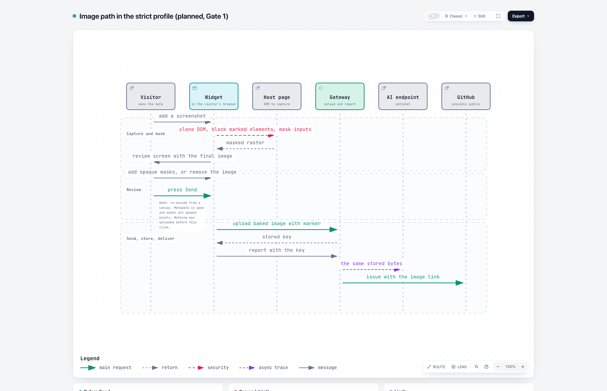

# Masking and public-repo safety

Status: accepted by the owner on 2026-11-10 for Gate 1 (S20 in [scope.md](scope.md)). It answers one question: how does a report with an image stay safe when its destination is a public GitHub repository, without making the widget hard to use?

## The problem

A report that lands in a public issue is readable by everyone. GitHub's image proxy also caches the image, so deleting it later does not recall it ([SECURITY.md](../SECURITY.md#camo-residual-risk)). The safe moment to protect data is therefore before the first byte leaves the visitor's browser.

What the code does today (read on 2026-11-10 at `3f3caba`):

| Fact | Where |
|---|---|
| A page screenshot is taken when the visitor presses the button, annotated in an editor, re-encoded to WebP at most 800 px wide, and uploaded when the visitor presses Send | `src/widget/index.ts:239`, `src/widget/lib/screenshot.ts:61-68`, `index.ts:301-305` |
| The capture filter skips only the widget's own host element. Nothing hides form values, password fields or marked elements | `src/widget/lib/screenshot.ts:58` |
| The annotation tools draw frames, arrows and text. None hides pixels | `src/widget/ui/annotate-model.ts` |
| A picked image uploads on pick and as the file itself, so metadata such as GPS stays. Removing it drops only the key | `src/widget/index.ts:396-404`, `src/widget/lib/api.ts:43-45` |
| The AI endpoint receives the stored image as a base64 data URL | `src/worker/orchestrate.ts:185`, `:459-468` |
| The page URL is cut to origin and path. Console capture is on by default and filtered by patterns for emails, tokens and long numbers | `index.ts:313`, `src/shared/contract.ts:154`, `src/widget/lib/pii-filter.ts` |

## What a report needs and what it risks

Debugging needs structure, errors and identifiers. It rarely needs the content of a page. So the strict profile covers content and keeps structure.

| Data | Helps debugging | Blast radius if public | strict | standard |
|---|---|---|---|---|
| Route (origin and path), app version, browser, viewport | high | low | sent | sent |
| Console errors and warnings | high | medium: a message can carry a payload | sent, strings and `Error` name and message only, objects become `[object]` | sent, pattern-filtered |
| Context the host page passes in (opaque IDs, versions, flags) | high | depends on what the host passes | sent, string values pattern-filtered like the console | sent |
| Screenshot: layout, controls, colors, state of the UI | high for visual bugs | low | sent | sent |
| Screenshot: text and images that are data (balances, transactions, names, messages, avatars, photos) | low to medium: the visitor's own words usually carry the point | high: personal, financial and third-party data | covered | visible |
| Form values and password fields | low | high | masked | masked |
| Elements marked `data-fk-private` | none by definition | high | blocked out | blocked out |
| What the visitor types into the report | it is the point | medium: the visitor chooses | visible, with a public hint | visible |
| A picked image | medium | high: photos, other windows | review required, metadata stripped | review offered, metadata stripped |

## Principles

1. Nothing leaves the browser until the visitor confirms exactly what will be sent.
2. A mask is destroyed pixels, baked into a re-encoded image. An overlay, a blur or a pixelation is not a mask.
3. Safe defaults beat settings. New projects start strict.
4. The server enforces what it can verify and says plainly what it cannot. It cannot see inside a pixel.
5. We promise no detection. We protect what the host page marks and what we know is sensitive, and we give the visitor a tool for the rest.

## The concept

### One profile per project

`privacy.profile` is `strict` or `standard`.

| Control | strict | standard |
|---|---|---|
| Form values and password fields in a capture | masked | masked |
| Elements with `data-fk-private` | blocked out | blocked out |
| Text and images in a capture (`capture.screenshot`) | `layout`: covered | `full`: visible |
| Images stay in the browser until Send, then are re-encoded | yes | yes |
| Review screen with the final image and a mask tool | required for every image | offered |
| Server requires the widget marker on uploads | yes | no |
| Console capture | errors and warnings, objects dropped | as configured |
| Hint "this report may be public" | when the destination is public or unknown | never |

New projects start strict. `standard` is allowed only for destinations that are private: the local inbox, and a GitHub repository or Project that the gateway has read as private. A public or unreadable destination forces strict, and the config check refuses `standard` with a clear error.

### Screenshot modes

`capture.screenshot` becomes `off`, `layout` or `full`. Today's `optional` stays and means `full`. Strict defaults to `layout`, standard to `full`. A strict project may set `full` on purpose, for example a docs site that shows nothing personal. The config check and `/diag` then say that page text is captured while the destination is public.

- `layout` keeps boxes, colors and borders, and covers every text and image.
- `data-fk-show` on an element keeps its text and images visible in `layout`, for error banners or navigation labels the host knows are safe.
- Masks are computed from the live layout after the page is rasterized: the client rectangles of every text node, input, textarea, select, image, canvas, video, iframe and every marked element, painted as opaque rectangles onto the canvas. The host page is not changed, and the result does not depend on how the rasterizer clones the DOM.
- Known gaps: closed shadow roots and text drawn by pseudo-elements. A canvas, video or iframe is covered as a whole. The sentinel test pins each of these.

### How the gateway knows a repository is public

With the project's token, the config check, the deep `/diag` and the test report read the repository from the GitHub API. The response has a `private` flag. This repository answers `private=false` today. A failed or unauthorized read counts as unknown, and unknown counts as public.

### The image path

[Open the explorable diagram](diagrams/privacy-image-path.html).

1. The visitor adds a screenshot or picks an image. Nothing is uploaded.
2. For a page capture, the widget rasterizes the page and paints opaque masks over form values, password fields and marked elements, and in `layout` over all other text and images. A picked image skips this step.
3. The review screen shows the final image. The visitor adds opaque rectangles over anything else, or removes the image.
4. On Send the widget bakes the image: it re-encodes from a canvas, so metadata is gone and every mask is an opaque pixel.
5. The widget uploads the baked bytes with a marker, then sends the report with the returned key.
6. The AI endpoint and the issue link receive the same stored bytes.

### The server contract

| Check | strict | standard |
|---|---|---|
| Marker present, else 409 | yes | no |
| Magic bytes, size cap, image only (exists today) | yes | yes |
| No metadata segments in the file (EXIF, XMP, text chunks), else 400 | yes | no |
| An upload that no report claims expires | yes | yes |

The marker keeps honest but outdated clients out. It does not stop a client that forges it. That client belongs to the visitor, who can only leak their own data. The host page is the other risk, and the host page controls the widget's environment anyway.

### The host page

A site marks what must never appear: `data-fk-private` on any element. Password fields need no mark. The widget documentation lists both.

### What we do not promise

- Detection of personal data in pixels or in text.
- Protection against a visitor who chooses to send data.
- Recall of an image that GitHub's proxy has already cached.
- Protection against a malicious host page.

## Acceptance

One Chromium test intercepts every request body and decodes the images.

| Test | Proves |
|---|---|
| A page with sentinel pixels, a sentinel in an input, in a marked element and in plain text and an image. The uploaded image has opaque fill in those regions and no sentinel. An element with `data-fk-show` stays readable in `layout`. The same test with masking off fails | Masks are destroyed pixels, and the test can fail |
| The same assertions for capture, pick, paste, drop and retry | Every input path is covered |
| Zero upload requests before Send, one per image after | Staging works |
| A JPEG with GPS metadata is picked. The uploaded bytes contain no metadata | Metadata is dropped |
| A strict project refuses an upload without the marker (409) and one with metadata (400), and accepts a baked image | The server contract |
| The bytes the AI endpoint receives hash equal to the stored bytes | One image, one truth |
| In strict, a logged object becomes `[object]` and an email in a host context value is redacted | The console and context rules |
| A mocked GitHub answers `private: false`, `true` and an error. The profile is forced, allowed, and forced | The visibility rule |

The capture library copies the value of every input and textarea into its clone (`html-to-image` 1.11.13, `es/clone-node.js:111-117`), so typed values can reach today's screenshots. The sentinel test shows what the pixels contain, and the fix is part of Gate 1.

## Rollout inside Gate 1

1. Widget: staging, re-encode, review screen and mask tool. Mock before build. The mask tool loads on demand, because the widget budget has 0.2 kB gz left.
2. Widget: automatic layer (form values, password fields, `data-fk-private`, and text and images in `layout`).
3. Gateway: profile setting, visibility check, marker and metadata checks, error codes in `docs/ERRORS.md`.
4. Tests and documentation, with the claim table of Step C updated.

## Open points for the PRs

- The marker's name and the new error codes.
- Wording of the public hint and the review screen, with `en` and `de` keys.
- The name `data-fk-show` and whether `optional` is renamed to `full`.
- Whether `role="alert"` banners stay visible in `layout` without a mark.
- Whether an operator may tighten the console rule inside `standard`.

Co-created by Michel with NORA (AI Agent)
