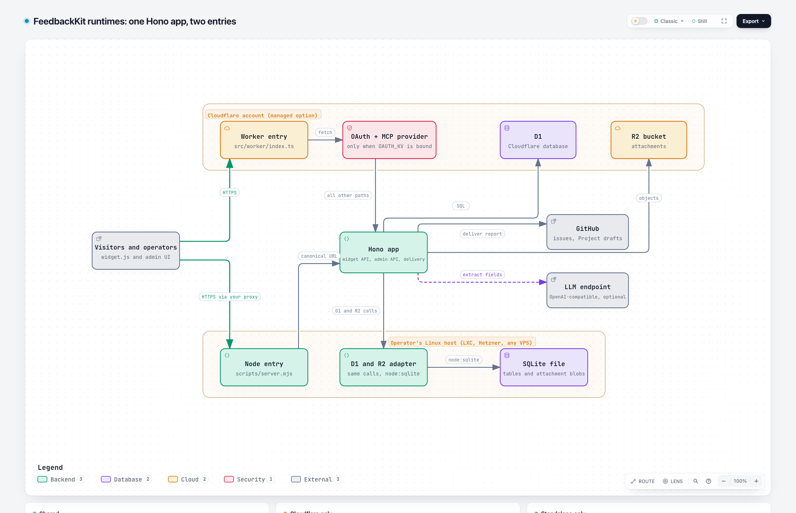

# What FeedbackKit is and what it is not

Status: proposed scope, challenged on 2026-11-10. Settled items name their source. Open items carry a recommendation and wait for the owner.

FeedbackKit completes a visitor's feedback while they are still on the page and delivers it as a structured report to a destination the operator owns. It does not manage the work that follows.

There are two ways to run it. Managed on Cloudflare, for operators who do not want to host anything. Self-hosted from a release tarball on any Linux host: a home Proxmox LXC, a Hetzner server or any other VPS. The self-hosted path is the primary one. Cloudflare is the convenient start.

Companion documents: [journeys](journeys.md) say how each role gets through each task, the [plan](autonomous-admin-plan.md) says in which reviewable steps the gaps close.

## Challenge result

Each premise of the sprint plan was checked against the code (branch `codex/admin-self-hosting`, review of 2026-11-10), the roadmap and the earlier owner decisions in `docs/design/admin-inbox-plan.md` (branch `design/admin-inbox-mockup`).

| Premise | Verdict | Why |
|---|---|---|
| Operators need full autonomy from Cloudflare | Keep, as a second runtime with a written single-node contract | The roadmap lists the Node/SQLite runtime as backlog with a Docker checkpoint (`docs/ROADMAP.md`, Backlog). That is a changed invariant, so it needs [ADR-016](../DECISIONS.md). The first standalone layer had five blocking defects in about 110 lines, so the second runtime must pass the same tests as the Worker. |
| Operators install and update the standalone server | A release tarball with a checksum. Operators do not build on the server. Docker and an npm package are backlog | Today an install needs Git, pnpm 11 and a build on the target (about 540 MB of dependencies). `/diag` reports `0.0.0` and `local`, releases carry only `widget.js`, and nothing tells an operator that a newer release exists. Owner decision 2026-11-10. |
| Local accounts with passkeys, invitations, roles and OIDC | Keep, but narrow and sequence it | Identity is a product of its own. The gateway has to know who may change settings. It does not have to be an identity provider. Sessions with bootstrap and recovery, then passkeys, with scoped API tokens replacing `ADMIN_TOKEN` (S11), then OIDC through a library. Two roles at first: owner and member. Accounts run on both runtimes (S12). |
| A simple Kanban for local reports | Keep as a view over the three existing states | Owner decision 2026-10-24: triage lives in GitHub, the local inbox stays minimal. A fourth state breaks old readers (`queries.ts` counts every value except `open` as handled). |
| PII masking has the highest priority | Keep, as a release gate with a testable design | Upload only after the visitor confirms the final review. Masks are burned into the pixels. Thumbnail, upload and AI call receive the same masked bytes. The server cannot verify a mask, so a project can require a marker that old widgets lack. |
| Settings through real UI controls | Keep, but the form must be safe by construction | The first form seeds numbers with `1`, pulls zod into the admin bundle (28.4 kB gz against a 15 kB budget) and enforces IDs only in the browser. |
| Retention of unhandled reports | Already decided: strict, with a 7-day notice | Owner decision 2026-10-24. The rule "a shortened `retentionDays` never deletes before the notice period" is not in `retention.ts` yet. |
| Private screenshots through an authenticated route | Already decided, and the standalone server breaks it | Owner decision 2026-10-24. An `` cannot send a bearer header, so inbox screenshots never load with token auth. |
| A stranger reaches a first report from the docs | Keep, with a claim-to-evidence table | Several statements are not backed by a test or a source yet (Node version, rollback behavior, deletion guarantees). |

## What FeedbackKit does

Status is `shipped` (on `main`), `branch` (on the WIP branch, not release-ready) or `planned`.

| Capability | Managed (Cloudflare) | Self-hosted (Node) | Status |
|---|---|---|---|
| Widget with follow-up questions, screenshot, console context | yes | yes | shipped |
| Feedback types with required fields, per-type destination | yes | yes | shipped |
| Delivery to a GitHub issue or GitHub Project draft, with retry | yes | yes | shipped |
| Local inbox: open, done, dismissed, note, delete | yes | yes | shipped |
| Settings revisions, publish with conflict detection | yes | yes | shipped |
| Run on a Linux host (home LXC, Hetzner server, any VPS) with SQLite | n/a | yes | branch |
| Install from a release tarball, update with one command, release shown in `/diag`, notice for a newer release | n/a | yes | planned |
| Settings form for types, fields, AI, appearance | yes | yes | branch |
| Create-only project API and New project dialog | yes | yes | branch |
| Local AI endpoint without a placeholder key | yes | yes | planned |
| Masked images only, uploaded after review | yes | yes | planned |
| Local accounts, passkeys, recovery | yes | yes | planned |
| Scoped API tokens for scripts and agents, replacing `ADMIN_TOKEN` | yes | yes | planned |
| OIDC sign-in (Pocket ID or any provider) | yes | yes | planned |
| Board view of the local inbox | yes | yes | planned |
| Team board embedded in the host's own UI, opened with a signed link (S21) | yes | yes | planned |
| Visitors follow their own local reports, identity signed by the host (S21) | yes | yes | planned |
| Widget preview and theme tokens | yes | yes | planned |
| MCP server with OAuth | yes | no | shipped (Cloudflare only) |

## What FeedbackKit does not do

| Not in the product | Reason | Revisit when |
|---|---|---|
| Session replay, click journeys, video | A separate privacy and product decision | The owner asks for it and writes the privacy position first |
| Automatic PII detection | It cannot be promised. The product offers manual masks and excludes marked elements and password fields | A detector with a measured miss rate exists |
| A public board of other people's reports | It exposes reports, which contradicts the privacy goal | A publish flag that carries a neutral summary is designed and accepted |
| Mirror of GitHub status, comments or assignees | GitHub owns the ticket | Never. Link out instead |
| A second ticket tracker (comments, assignees, custom lanes, SLAs) | The inbox is not the product's edge (CEO review 2026-10-24) | A paying use case without GitHub appears |
| Public sign-up, mandatory mail provider, mandatory external identity | Autonomy is the point | Never as a requirement |
| Several replicas on one database | SQLite on one disk, one process | A second storage backend is accepted by ADR |
| MCP and OAuth on the standalone server | ADR-015 builds consent on Cloudflare Access | A separate ADR defines consent without Access |
| User-owned GitHub Projects, GitLab, Jira, Trello | No fine-grained permission for user Projects, and demand is unproven | A demand checkpoint is reached |
| TLS termination, reverse proxy, backups of the host | The operator's infrastructure | Never |
| Hosted FeedbackKit offering | Operators host it themselves, on Cloudflare or on their own Linux host | A business decision, not a code change |
| Docker image and Compose file | The roadmap made Docker demand-gated, it was never run on this branch, and the target operator runs an LXC | A defined number of external operators ask for it (the roadmap checkpoint names N but gives no value) |
| npm registry package | A publish token and a package namespace add supply-chain surface that a checksummed tarball does not need | Operators ask for `npm i -g` |
| Building on the server (Git, pnpm, compiler) | Operators install a finished bundle. Maintainers build in CI | Never for operators. `pnpm` stays the maintainers' tool |

## Runtime contract for the standalone server

[Open the explorable diagram](diagrams/runtime-architecture.html). Its source references are pinned to commit `e712a01`.

1. One node, one process per database. SQLite in WAL mode on a persistent local disk.
2. The same Hono application and the same behavior tests as the Worker. A difference between the runtimes is a bug or an entry in the parity table of `docs/SELF_HOSTING.md`.
3. Node.js 24 is the floor (S19). The Node documentation labels `node:sqlite` in v24 "Stability: 1.2, release candidate" (nodejs.org, checked 2026-11-10). One version number appears in `engines`, CI and the docs.
4. Delivered as a release tarball that CI builds from a tag, with a signed checksum file. The target needs Node.js 24 and the standard tools curl, tar, sha256sum and ssh-keygen (OpenSSH 8.0 or newer). It needs no Git, no pnpm, no build and no container. The tarball holds a single-file server, the widget and admin assets, the migrations, the systemd unit and a file that records release, delivery capability and schema version.
5. `/diag` reports schema, capability and whether stored settings need a newer release than the one running.
6. Secrets come from environment variables or the service's environment file. The process hands the application an allowlist of them, not its whole environment.

## Decisions

Settled decisions:

| ID | Decision | Source |
|---|---|---|
| S1 | Three deliveries per type: issue, project draft, local. GitHub owns ticket state | `admin-inbox-plan.md`, 2026-10-24 |
| S2 | Retention is strict and counts from submission, with a 7-day notice for unhandled reports | same, decision 1 |
| S3 | Screenshots of project and local deliveries are served through an authenticated route | same, decision 2 |
| S4 | No acknowledged loss: a report is confirmed only after it is stored | ROADMAP invariant 5 |
| S5 | The LLM client is OpenAI-compatible and optional | ADR-007, ROADMAP invariant 3 |
| S6 | Appearance is themed per host through tokens on a neutral base | Owner, 2026-10-07 |
| S7 | Most backend settings are managed through UI controls, with JSON as the escape hatch | Owner, 2026-11-09 |
| S8 | The standalone server ships as a release tarball with a signed checksum. Operators do not build. Docker and an npm package are backlog | Owner, 2026-11-10 |
| S9 | Standalone releases follow the channels of ADR-013: stable releases and dev pre-releases, default stable. Details in Step D of the plan | Owner, 2026-11-10 |
| S10 | Releases are signed. `SHA256SUMS` carries an OpenSSH Ed25519 signature (`ssh-keygen -Y`). The stable key is a secret in the `production` environment of the release workflow. Dev pre-releases are signed with a separate dev key in the `dev` environment, and the update command accepts a dev key only on the dev channel. The public keys ship in every bundle and in the docs. The rotation procedure is written and rehearsed before the first signed release. Confirm `ssh-keygen -Y` on the target in Step 3 | Owner, 2026-11-10 (key custody, D-08). The separate dev key is my addition for the same decision |
| S11 | `ADMIN_TOKEN` is replaced by accounts. Once the first owner exists it no longer grants access. Scripts and agents use scoped API tokens that an owner creates, so scoped tokens move from Step 4 into Gate 2 | Owner, 2026-11-10 (D-02) |
| S12 | Local accounts exist on both runtimes (SQLite and D1) and one conformance suite covers them. Gate 2 gains a D1 design and a recovery path for Cloudflare | Owner, 2026-11-10 (D-03) |
| S13 | Cloudflare is the managed path for operators who do not want to host anything. The Node runtime is the self-hosted path and runs on any Linux host, for example at Hetzner | Owner, 2026-11-10 |
| S14 | The first owner proves control with a one-time link printed by a host command. On Cloudflare a script run with the operator's Cloudflare credentials prints it. It is the same mechanism as recovery. No static bootstrap secret remains, and the server stops needing `ADMIN_TOKEN` to start once Gate 2 ships | Owner, 2026-11-10 (D-09) |
| S15 | Cloudflare Access stays an accepted admin identity on the Cloudflare runtime beside accounts, and stays optional. ADR-015 keeps building MCP consent on it | Owner, 2026-11-10 (D-10) |
| S16 | ADR-016, the standalone Node runtime, is accepted. The conformance suite and the single-node contract are part of it. The runtime counts as supported only after R1 to R9 are closed, one Node floor is chosen, Step D exists and Step 3 has run | Owner, 2026-11-10 (D-01) |
| S17 | The board keeps three lanes and gets no "in progress" lane. GitHub owns ticket state (S1). A fourth lane would need an expand-only schema plan and a fix in `queries.ts` | Owner, 2026-11-10 (D-05) |
| S18 | OIDC (Step 6) links an identity to an account by `iss` and `sub`. The link is made through an invitation or from a signed-in session. Email equality grants nothing, so an unverified or recycled address cannot take over an account | Owner delegated the choice, 2026-11-10 (D-04) |
| S19 | Node 24 is the floor. `engines` says `>=24`, CI runs Node 24 and, once a newer LTS line exists, that one too, and the docs name one version. Node 22 is unsupported | Owner delegated the choice, 2026-11-10 (D-06) |
| S20 | Masking follows the concept in [privacy-masking.md](privacy-masking.md). A project has a `privacy.profile` of `strict` or `standard`. New projects start strict, and a public or unreadable destination forces strict. In strict a screenshot keeps layout and covers text and images, console capture keeps errors and warnings with objects dropped, and host context values are filtered | Owner, 2026-11-10 (D-07) |
| S21 | Projects without GitHub get two embeds, both after Gate 2 and Step 5 and both for local-delivery reports only. First a team board in an iframe that opens with a short-lived signed link, minted by the host backend with a scoped token. Then an own-reports view whose identity is signed by the host backend. A public board of other people's reports stays out. Comments, assignees and SLAs stay out | Owner, 2026-11-10 (D-11) |

No decision is open. The open points that belong to single pull requests are listed at the end of [privacy-masking.md](privacy-masking.md).

Co-created by Michel with NORA (AI Agent)
